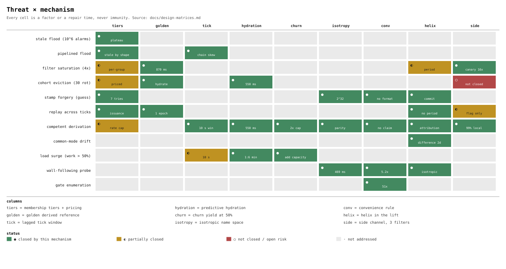
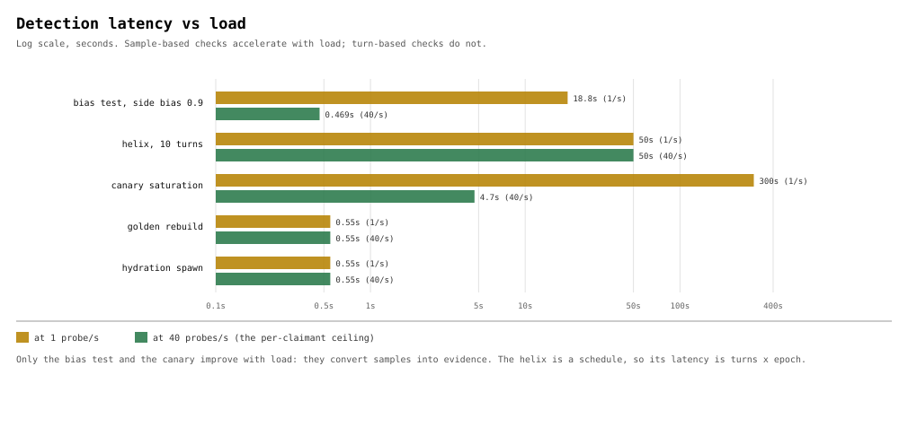

# Design matrices — every number in one place

A consolidation, not a new decision. Each cell names the ADR that measured it and the test
that produces it; the tests are the source of truth and this page is the index.

Generated by `tools/design-matrices.py`. Two diagrams are emitted from the same data:
`design-matrices.svg` (the threat × mechanism grid, coloured by status) and
`design-matrices-latency.svg` (latency against load, log scale).


## 1. Decisions at a glance

| ADR | decision | load-bearing number | test |
|---|---|---|---|
| [0001](adr/0001-alarm-membership-tiers.md) | membership tiers: non-members get the alarm, members the station | 30 rotations to evict; 8 vs 24 pricing | `TestAlarmRotationsEvictTheCohort` |
| [0002](adr/0002-golden-is-a-derived-reference.md) | golden is a derived reference, not a snapshot | 870 ms rebuild; twice over in a 5 s tick | `TestRepairFitsTwiceInATick` |
| [0003](adr/0003-lagged-tick-window.md) | one lagged tick: a 10 s acceptance window | window = 2 epochs = 10 s | `TestTwoLiveEpochsDoubleTheAttackersCost` |
| [0004](adr/0004-predictive-hydration.md) | predictive hydration from the next tick | 550 ms lead vs 60 ticks cold | `TestGoldenSpawnsHydratedNodes` |
| [0005](adr/0005-punish-floods-reward-derivation.md) | punish floods, reward derivation | churn >= work: 2x provisioning | `TestFiftyPercentSetpointIsTheProvisioningRule` |
| [0006](adr/0006-the-name-space-is-isotropic.md) | the name space is isotropic | 19 probes, 469 ms at 40/s | `TestWallFollowerIsCaughtByItsOwnBias` |
| [0007](adr/0007-conveniences-are-attack-surfaces.md) | conveniences are attack surfaces; harden on introduction | 5 reasons = 2.32 bits/probe; 51x at 5 gates | `TestRefusalReasonIsAGuidanceOracle` |
| [0008](adr/0008-rotation-as-a-helix-of-residues.md) | rotation state as a helix in the torsion-free lift | period 30 at {2,3,5}; no period in the lift | `TestCoprimeHelicesReconstructTheIndex` |
| [0009](adr/0009-the-side-channel-three-filters.md) | the side channel is three filters with three polarities | 16.1x canary lead; 1.05% escalation | `TestCanaryFilterWarnsSixteenTimesEarlier` |
| [0010](adr/0010-trust-rotates-with-the-layout.md) | trust rotates with the data layout (parity schedule) | duty 1/n; k ticks cost k members | `TestTrustRotationCostsDuration` |
| [0011](adr/0011-redundancy-is-a-route-property.md) | redundancy is a route property: replicas, placement, blocks | 2 replicas = 99.99%; rendezvous moves 19.7% | `TestResizeCostDependsOnTheFunction` |

## 2. Threat × mechanism

`●` closed, `◐` partial, `·` not addressed. The short token is the mechanism's
contribution, not a claim of immunity.

| threat | membership tiers + pricing | golden derived reference | lagged tick window | predictive hydration | churn yield at 50% | isotropic name space | convenience rule | helix in the lift | side channel, 3 filters |
|---|---|---|---|---|---|---|---|---|---|
| stale flood (10^6 alarms) | ● plateau | · | · | · | · | · | · | · | · |
| pipelined flood | ● stale by shape | · | ● chain skew | · | · | · | · | · | · |
| filter saturation (4x) | ◐ per-group | ● 870 ms | · | · | · | · | · | ◐ period | ● canary 16x |
| cohort eviction (30 rot) | ◐ priced | ● hydrate | · | ● 550 ms | · | · | · | · | ○ not closed |
| stamp forgery (guess) | ● 7 tries | · | · | · | · | ● 2^32 | ● no format | ● commit | · |
| replay across ticks | ● issuance | ● 1 epoch | · | · | · | · | · | ● no period | ◐ flag only |
| competent derivation | ◐ rate cap | · | ● 10 s win | ● 550 ms | ● 2x cap | ● parity | ● no claim | ● attribution | ● 99% local |
| common-mode drift | · | · | · | · | · | · | · | ● difference 2d | · |
| load surge (work > 50%) | · | · | ◐ 10 s | ● 1:6 min | ● add capacity | · | · | · | · |
| wall-following probe | · | · | · | · | · | ● 469 ms | ● 5.2x | ● isotropic | · |
| gate enumeration | · | · | · | · | · | · | ● 51x | · | · |

## 3. Error polarity

| mechanism | key | false positive means | may decide? | known limit |
|---|---|---|---|---|
| parental filter (admission) | (tick, rotation) | admit a stranger | only with golden repair | cannot see replay across ticks |
| replay filter | rotation | accuse an honest node | never - flag only | sees repeats, not intent |
| canary filter | route | none - saturation is the signal | yes, volume alarm | no signal until 4n |
| residue helix | lift mod m | none - detected by expectation | yes, position | period = lcm |
| inversion gate | issued value | N/A - equality | yes, receipt | period 2 abelian |
| bias test | side choice | none - statistical | no - not an attestation | needs 19 probes |

## 4. Cost and timing

| mechanism | time | memory | messages | latency | load-sensitive |
|---|---|---|---|---|---|
| tiers + pricing | 0 flags | 7 or 2 alarms/identity | 1 per alarm | immediate | no |
| golden rebuild | 870 ms | n x 32 B transfer | 0 messages | 870 ms | no |
| lagged tick | 0 | 0 | 0 | 10 s window | no |
| hydration | 550 ms | n x 32 B | 0 messages | 550 ms lead | no |
| churn yield | 0 | 26-32 bits/item | 0 | epoch x turns | yes |
| isotropy test | 0 | 0 | 0 | 469 ms at 40/s | yes - faster |
| convenience rule | 0 | 0 | 0 | uniform refusal | no |
| helix residues | 0.78 ns | 3 words | 0 extra | 10 turns = 50 s | no |
| HMAC envelope | 478 ns | 0 | same message | 0 | no |
| group commitment | 47 ns | 1 element | same message | 0 | no |
| canary filter | 0 | bits x 1/16 n | 0 | 186 insertions | yes |
| side channel | 0 | 10 bits/turn | 0 on 99% | local | no |

## 5. Detection latency vs load

| check | at 1/s | at 40/s | improves with load? | exactness |
|---|---|---|---|---|
| stale flood refusal | 0 | 0 | no | exact |
| bias test (0.9 side bias) | 18.8 s | 469 ms | yes - faster | 99.9% in 10 turns |
| helix (3 residues) | 50 s | 50 s | no | exact per turn |
| canary saturation | minutes | 4.7 s | yes - faster | exact count |
| golden rebuild | 870 ms | 870 ms | no | 0.82% FP |
| hydration lead | 550 ms | 550 ms | no | 60 ticks of cold |
| gate enumeration | 5 probes | 5 probes | no | exact |

## 6. Tick budget at 10^6 routes

One cycle of a golden cluster tracking a million routes, with durability. The
branch is whether the durable path carries the records or the derivation.

| stage | derived path | one shared store | 4 member-local stores |
|---|---|---|---|
| derive records | - | 100 ms | 100 ms (parallel) |
| hash into the filter | - | 550 ms | 550 ms (parallel) |
| SQLite commit | 0.1 ms (manifest row) | **10.0 s** (1 M rows at 100 k rows/s) | 0.83 s (250 k rows each) |
| object store, 2 copies | 65 ms (3.25 MB filter) | 640 ms (32 MB) | 160 ms (8 MB slice each) |
| **total** | **65 ms** | **11.3 s = 2.26 ticks** | **0.99 s = 0.20 ticks** |
| twice-over margin | 38x | **fails** (needs 22.6 s) | **2.5x** |

Twice-over holds at **2 members** on local stores or **4** through a shared one; total bytes shipped are unchanged, so the gain is locality and parallelism, not less work.

| path | cost | relation to the 5 s tick |
|---|---|---|
| live repair from derivation | 870 ms | fits, twice over |
| durable write per tick | 65 ms | 77x inside a tick |
| cold restore from the store | 10.3 s | 2.06 ticks, 12x the live repair |

## 7. The ledger

| quantity | value | unit | ADR | test |
|---|---|---|---|---|
| alarms to evict a cohort | **30** | rotations | 0001 | `TestAlarmRotationsEvictTheCohort` |
| cost of a forged stamp | **8** | distance | 0001 | `TestHoneypotInvocationIsTheAlarmsReceipt` |
| cost of a direct call | **24** | distance | 0001 | `TestQuorumMultipliesTheAttackCost` |
| cost of past-grace staleness | **2** | distance | 0001 | `TestAlarmFloodSaturatesTheFilter` |
| budget cost of groups of 3 | **1.33** | x membership | 0001 | `TestGroupsOfThreeRestoreScaleInvariance` |
| global filter at 100 ingresses | **4** | % correct | 0001 | `TestIngressParallelismMultipliesTheAttacker` |
| golden rebuild, warm | **870** | ms | 0002 | `TestGoldenRebuildWinsTheRace` |
| rebuild, hashing only | **550** | ms | 0002 | `TestGoldenRebuildWinsTheRace` |
| rebuilds absorbed by one tick | **5** | rebuilds | 0002 | `TestRepairFitsTwiceInATick` |
| twice-over margin at 1M | **2.87** | x | 0002 | `TestRepairFitsTwiceInATick` |
| twice-over holds to | **2.9** | M entries | 0002 | `TestRepairFitsTwiceInATick` |
| rebuilt filter FP | **0.82** | % | 0002 | `TestGoldenChangesThePayoffNotTheArithmetic` |
| saturated filter FP at 4x | **54** | % | 0002 | `TestAlarmFloodSaturatesTheFilter` |
| content agreement cost | **0** | messages | 0002 | `TestGoldenAnchorGivesContentAgreementForFree` |
| cold restore | **300** | s | 0002/0004 | `TestColdGoldenIsTheOnlyWayToLose` |
| acceptance window | **10** | s | 0003 | `TestTwoLiveEpochsDoubleTheAttackersCost` |
| hydration lead | **550** | ms | 0004 | `TestGoldenSpawnsHydratedNodes` |
| hydration idle reduction | **545** | x | 0004 | `TestGoldenSpawnsHydratedNodes` |
| cold spawn lateness | **60** | ticks | 0004 | `TestGoldenSpawnsHydratedNodes` |
| churn setpoint | **50** | % work share | 0005 | `TestFiftyPercentSetpointIsTheProvisioningRule` |
| provisioning rule | **2** | x work load | 0005 | `TestFiftyPercentSetpointIsTheProvisioningRule` |
| bits per item at nominal churn | **26** | bits | 0005 | `TestYieldingCostsBitsPerItem` |
| bits added per churn halving | **1-2** | bits | 0005 | `TestYieldingCostsBitsPerItem` |
| replay-safe yield band | **0** | turns | 0005 | `TestTheYieldBandIsEmpty` |
| bias test at 0.9 | **19** | probes | 0006 | `TestWallFollowerIsCaughtByItsOwnBias` |
| bias test latency at 40/s | **469** | ms | 0006 | `TestDetectionLatencyIsStepsOverRate` |
| quadratic subtlety cost | **4** | x per halving | 0006 | `TestSubtletyCostsQuadratically` |
| random walk over 32 bits | **3.4** | years at 40/s | 0006 | `TestRandomizedFollowingIsJustAGuess` |
| one-sided vs two-sided cost | **5.2** | x | 0006 | `TestTheCheapOneSidedTestDoesNotApply` |
| invariant signal across 30 rotations | **1** | distinct answers | 0007 | `TestStaticInvariantCannotMeasureRotation` |
| lazy node invariant health | **30/30** | ticks | 0007 | `TestStaticInvariantCannotMeasureRotation` |
| refusal reasons on the wire | **5** | classes | 0007 | `TestRefusalReasonIsAGuidanceOracle` |
| guidance per refusal | **2.32** | bits | 0007 | `TestRefusalReasonIsAGuidanceOracle` |
| blindness multiplier at 5 gates | **51** | x | 0007 | `TestGuidanceIsAdditiveWhereBlindnessIsMultiplicative` |
| blindness multiplier at 8 gates | **2048** | x | 0007 | `TestGuidanceIsAdditiveWhereBlindnessIsMultiplicative` |
| helix period at 2,3,5 | **30** | turns | 0008 | `TestCoprimeHelicesReconstructTheIndex` |
| helix period at 2,3,5,7 | **210** | turns | 0008 | `TestCoprimeHelicesReconstructTheIndex` |
| attribution delta (path 2,3,5) | **15/20/6** | index steps | 0008 | `TestTheDeltaNamesTheLiar` |
| non-coprime pair 2,4 period | **4** | turns | 0008 | `TestNonCoprimeModuliWasteAPath` |
| inversion replay pass rate | **100** | % | 0008 | `TestInversionHasPeriodTwo` |
| non-abelian periods | **4 and 3** | turns | 0008 | `TestNonAbelianConjugationSetsThePeriod` |
| residue cost | **0.78** | ns | 0008 | `BenchmarkResidue` |
| HMAC-SHA256 cost | **478** | ns | 0008 | `BenchmarkHMACSHA256` |
| 61-bit modexp cost | **47** | ns | 0008 | `BenchmarkGroupCommit` |
| helix CPU duty at 5 s | **0.0001** | % of core | 0008 | `TestCommitCostsAreIrrelevantAtThisEpoch` |
| phase 1/30 order | **30** | steps | 0008 | `TestPhasesAreAQuotientAndHaveTorsion` |
| phase-keyed filter after a wrap | **30/30** | false returns | 0008 | `TestFilterOverTheQuotientSaturates` |
| fast path resolved locally | **99** | % | 0008 | `TestFastPathIsAnExclusionChannel` |
| canary warning lead at 1/16 | **16.1** | x earlier | 0009 | `TestCanaryFilterWarnsSixteenTimesEarlier` |
| design FP, full and canary | **0.82** | % | 0009 | `TestCanaryFilterWarnsSixteenTimesEarlier` |
| slow-path escalation rate | **1.05** | % | 0009 | `TestSideChannelDrainsTheUnexaminedBacklog` |
| flooded canary FP | **87.7** | % | 0009 | `TestPerRouteCanariesLocalizeAFlood` |
| derived durable write, 1M routes | **65** | ms/tick | 0002 | `TestDerivedPathFitsTheTickTwiceOver` |
| materialized durable write | **11.3** | s = 2.26 ticks | 0002 | `TestMaterializedPathBreaksTheTick` |
| store rate for twice-over | **400** | k rows/s | 0002 | `TestMaterializedPathBreaksTheTick` |
| filter artifact at 26 bits/item | **3.25** | MB | 0002 | `TestDerivedPathFitsTheTickTwiceOver` |
| cold restore from object store | **10.3** | s = 2.06 ticks | 0002 | `TestColdRestoreFromObjectStore` |
| cold restore vs live repair | **12** | x | 0002 | `TestColdRestoreFromObjectStore` |
| locality factor, local vs shared store | **3** | x rows/s | 0001 | `TestMembershipPartitionsTheDurablePath` |
| members for twice-over, local stores | **2** | shards | 0001 | `TestMembershipPartitionsTheDurablePath` |
| members for twice-over, shared store | **4** | shards | 0001 | `TestMembershipPartitionsTheDurablePath` |
| member-local pipeline, 4 shards | **0.99** | s/tick | 0002 | `TestMembershipTurnsElevenSecondsIntoOne` |
| membership improvement over shared | **11.4** | x | 0001 | `TestMembershipTurnsElevenSecondsIntoOne` |
| verifier duty, single parity | **1/n** | of ticks | 0010 | `TestLeftSymmetricRotatesTrustAndData` |
| control cost, k consecutive ticks | **k** | members | 0010 | `TestTrustRotationCostsDuration` |
| control cost, dual parity | **2k** | members | 0010 | `TestDualParityDoublesTheVerifierSet` |
| data residence per member | **1** | tick | 0010 | `TestDataResidenceIsOneTick` |
| members to follow one shard | **n** | of n | 0010 | `TestDataResidenceIsOneTick` |
| write amplification per-record durability | **625** | x | 0002 | `TestWriteAmplificationIsTheRealConstraint` |
| RAID-5 rebuild, n=4 | **320** | ms | 0002 | `TestParityRebuildVersusDerivation` |
| derivation rebuild (no transfer) | **550** | ms | 0002 | `TestParityRebuildVersusDerivation` |
| availability, 2 route replicas | **99.99** | % | 0011 | `TestRouteReplicasFollowAvailabilityMath` |
| resize churn, modulo placement | **80.2** | % keys moved | 0011 | `TestResizeCostDependsOnTheFunction` |
| resize churn, rendezvous placement | **19.7** | % keys moved | 0011 | `TestResizeCostDependsOnTheFunction` |
| blocks self-served at 1 replica | **25** | % | 0011 | `TestSelfServeConflictAtBlockGranularity` |
| directory entries for placement | **0** | entries | 0011 | `TestPlacementIsByFunctionNotDirectory` |
| shared filter after same traffic | **0.000** | FP | 0009 | `TestPerRouteCanariesLocalizeAFlood` |


## 8. Diagrams





The **isotope view** is a third reading of the same data: each threat class resolved into its
variants, with every mechanism drawn as a decay channel and a daughter state. It is decided in
[ADR 0012](adr/0012-the-isotope-view-is-the-chart-of-the-nuclides.md) and rendered as a
standalone view in `ui/xcode/Lab/LezzSea`.

The **dispersion** reading — prism, rotation, reference arm — is the fourth: mechanisms
deflect rather than block, and the deflection angle is 42i distance. It is decided in
[ADR 0013](adr/0013-the-stream-is-dispersed-not-filtered.md).

## 9. What the matrices say together

- **Every mechanism is a rate discipline.** Nothing in the grid closes a threat absolutely;
  each cell is a factor or a repair time.
- **Three guarantees, three budgets.** Route replicas buy availability (2 = 99.99%, the knee),
  rendezvous placement buys addressability with no directory and 19.7% churn on resize, and
  parity buys block durability. Conflating them yields high availability with lost data: two
  replicas and no parity still lose a quarter of a block on one member loss.
- **Trust is placed by the same function as the data.** Left-symmetric parity gives every
  member the verifier role 1/n of the time, makes self-verification structurally impossible,
  and turns control duration into a cost: k consecutive ticks needs k members where a static
  verifier needs one. Data residence is a single tick, so following one shard needs the whole
  membership.
- **Membership is the missing dimension.** The records do fit - not by storing fewer, but by
  partitioning across tracked members: 11.3 s shared becomes 0.99 s at four shards, because
  the critical path is the slowest writer, not the sum. Two members suffice on local stores
  (3x faster than a coordinated shared one); four if everyone shares. That is what joining
  buys, and why being tracked is the price of the fast path.
- **The durable path cannot carry the records.** At a million routes per cycle, writing rows
  through SQLite is 10 s of an 11.3 s pipeline, which needs a store sustaining 400 k rows/s
  to fit twice over. The durable artifact has to be the derivation and the filter: 65 ms, 38x
  margin. Cold restore then costs 2.06 ticks, which is acceptable only because repair never
  reads the store.
- **The tick is a budget, not a convention.** A full rebuild at 10^6 entries is 870 ms, so
  `2 x 870 ms = 1.74 s` fits a 5 s epoch with a 2.87x margin, and one tick absorbs five
  rebuilds. That is what makes "a collapse is fixable before the next tick, twice over" a
  number rather than an intention; it holds to 2.9M entries and fails beyond them. Hydration
  is the cheaper 550 ms figure because it re-derives locally, with no transfer.
- **The open cells are honest.** Cohort eviction is not prevented by the side channel; a
  competent deriver is capped, not excluded; the refusal oracle is specified and not yet
  implemented.
- **Polarity, not strength, is the recurring hazard.** Five of the six rows in matrix 3 have
  a false positive that means something *different*, and two of them invert the security
  meaning of the same bit.

## Verifying

```sh
go test ./internal/mcp_faults/ -count=1
python3 tools/design-matrices.py   # regenerates this page and both diagrams
```
