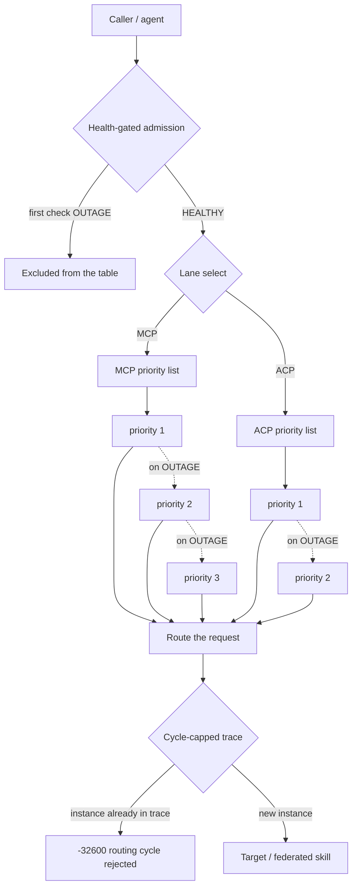
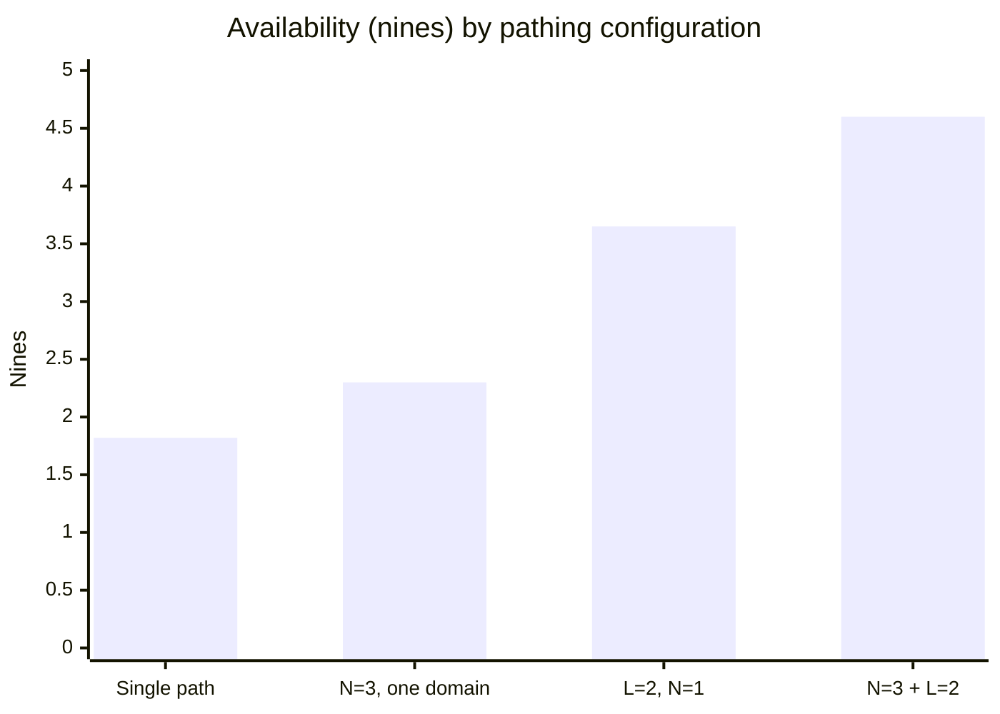
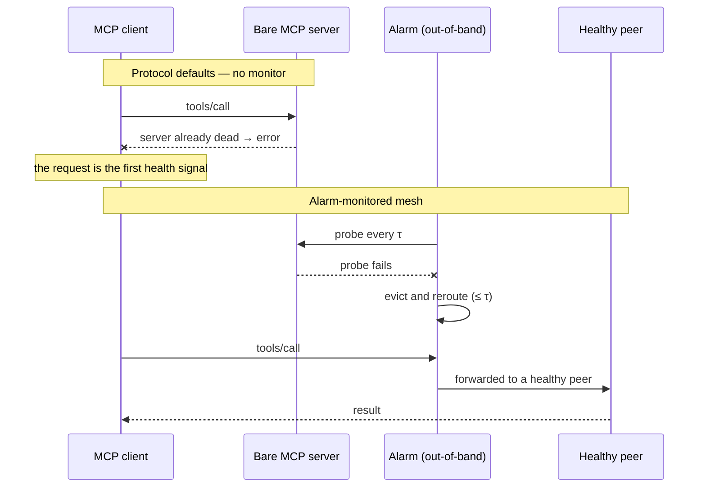

# Request-Pathing Blast Radius and Fault Tolerance

ocd-smoke-alarm is described as resilient, but "resilient" hides which failure each mechanism absorbs. This document separates the alarm's request-pathing **styles**, gives each one an availability expression and a blast-radius bound, and shows that they act on *different terms of the same equation* — which is why no single style is sufficient and why they have to mesh.

> [!NOTE]
> Grounded in [MCP/ACP Priority Routing and Self-Healing](features/catalog/routing.md), [Federation Mesh](features/catalog/federation.md), and [mDNS Peer Discovery](features/catalog/mdns-discovery.md); [Client Request Flow](request-flow.md) traces the requests these paths carry. The formulas are a modelling lens, not measured production data.

## What "pathing" means here

Pathing is everything between "a request exists" and "an endpoint serves it":

- **Admission** — who is even allowed into the table.
- **Failover** — which instance serves, in priority order.
- **Lane selection** — MCP or ACP, each with its own independent list.
- **Mesh coordination** — how instances learn about one another.
- **Forwarding** — how far a request may travel, and when it is refused.
- **Suppression** — which failures count as real.



## Notation

| Symbol | Meaning |
|---|---|
| `a` | per-instance availability at request time; `q = 1 − a` |
| `q_i` | independent (per-replica) failure probability |
| `q_c` | common-mode failure probability shared inside one failure domain |
| `N` | failover depth — replicas in one priority list |
| `L` | number of independent lanes / failure domains |
| `M` | mesh size; a routing trace cannot repeat an instance, so path length ≤ `M` |
| `τ` | probe interval — the health-check cadence (routing evicts within one interval) |
| `T` | probe timeout — the per-attempt bound on a single health check |
| `MTBF` | mean time between failures of the active instance |
| `λ` | request arrival rate |
| `A_sys` | system availability for a request |
| `ε` | detection tax — requests that hit a failed-but-not-yet-evicted instance, `ε ≈ (τ/2 + T) / MTBF` |

Every replica failure splits into an independent part and a shared-fate part: `q = q_i + q_c`. That split is the whole story.

**Blast radius** is reported as a triple: **reach** (components affected), **traffic share** (fraction of requests affected), and **time span** (how long the effect lasts).

## Code-grounded constants

The cadence is not a free parameter — it comes from the service **efficiency profile**, resolved in `internal/config/config.go`. With no explicit profile the loader selects `auto → medium`, so the table is the entire default story:

| Constant | `low` | `medium` (default) | `high` |
|---|---|---|---|
| `poll_interval` (`τ`) | 60 s | **15 s** | 5 s |
| `timeout` (`T`) | 10 s | **5 s** | 3 s |
| `max_workers` | 1 | **4** | 8 |

Validation clamps `max_workers` to `[1, 2048]`; the hard fallbacks when a profile leaves a field blank are `poll_interval: 15s`, `timeout: 5s`, `max_workers: 4`.

The failure and recovery semantics carry their own defaults:

| Behaviour | Default | Where |
|---|---|---|
| Per-target `retries` | `0` (validated `0–100`) | `internal/config/config.go` |
| `sustain_success_before_mark_healthy` | `2` consecutive healthy probes | `known_state` defaults |
| `outage_threshold_consecutive_failures` | `2` consecutive failures | `known_state` defaults |
| New failure after a healthy baseline | classified `regression` | `known_state` defaults |
| Federation `heartbeat_interval` / `heartbeat_timeout` | `15 s` / `45 s` | `internal/config/config.go` |

Substituting these, the alarm's own latencies at the **default (medium)** cadence:

- **Detection / failover window** — mean `τ/2 + T = 12.5 s`, worst case `τ + T = 20 s`; routing evicts immediately once a check fails.
- **Outage escalation** — `outage_threshold × τ ≈ 30 s` (or sooner: the first failure after a healthy baseline is classified `regression` and can fire on that probe).
- **Re-admission after recovery** — `sustain × τ ≈ 30 s` before an instance is re-marked healthy.

So "MTTR" as the *alarm* sees it is the instance's real repair time **plus** a fixed `sustain × τ` re-trust lag — the code cannot make recovery detection faster than the cadence either.

## The styles, one at a time

| Style | Mechanism | Availability contribution | Blast radius | Weak alone |
|---|---|---|---|---|
| **S0 Single path** | one endpoint, one protocol | `A = a` | reach 1, traffic 1.0, time = downtime | any failure is total |
| **S1 Priority failover** | route to the highest healthy instance; fall down the list on OUTAGE; hold and alert when all are down | `A = 1 − q^N` (steady state) | reach 1, traffic `1/N`, time `≤ τ` | correlated failures cap `A` at `1 − q_c` |
| **S2 Same-priority load-share** | two instances at equal priority split load | lowers `q` by moving the overload threshold from `C` to `2C` | traffic ½ | only helps if the two are independent |
| **S3 Independent lanes** | MCP and ACP priority lists are entirely separate; an ACP-only outage fails ACP over while MCP keeps routing | `A = 1 − q_M·q_A` | reach 1 lane, traffic `1/L` | a single process hosting both collapses the union |
| **S4 Mesh fan-out + election** | first binder wins the introducer slot; followers claim the next ports; silent peers age out | control-plane availability via slot lock (stale-PID recovery) | reach = membership churn, **not** traffic | no live introducer promotion is specified, so control-plane writes pause until the slot is reclaimed |
| **S5 Proxy chains** | multi-hop forwarding to reach a federated skill; a trace may not repeat an instance | `A = a^h` | reach grows with `h`; capped at `M` | geometric unavailability — this is *reach*, not redundancy |
| **S6 Chaos suppression** | a registered, in-window chaos isotope is not a real failure; unregistered or out-of-window failures evict | `q_eff = q_real + q_chaos·(1 − s)`, `s` = correctly registered-and-in-window share | a chaos test cannot widen into production routes | a mis-registered isotope is treated as real (fail-safe direction) |
| **S7 Health-gated admission** | no instance enters the active set without a passing check; a first OUTAGE keeps it out | removes the cold-start failure class | a bad node never receives traffic | it is a gate, not a repair |

**S4 is the counter-intuitive one.** The mesh's *data plane* — the routing tables — is populated by the continuous [mDNS browser](features/catalog/mdns-discovery.md) and rebuilt from mDNS state on restart. Losing the introducer therefore degrades *membership updates*, not the routing of live traffic. Control-plane failure is not data-plane failure, and that decoupling is what keeps the mesh blast radius small.

## The canonical expression

Composing the layers, a request's availability is approximately:

```
A_sys  ≈  1 − ( q_c + q_i^N )^L − ε ,      ε ≈ (τ/2 + T) / MTBF
```

Each factor is a different operator:

- **`q_i^N` — redundancy (exponent work).** Each extra replica multiplies the *independent* failure probability by `q_i`. This is S1 and S2.
- **`( … )^L` — independence (base work).** `L` independent domains raise the whole per-domain term to a power. This is S3 and S4.
- **`q_c` — the common-mode floor.** Redundancy cannot touch it; it is the availability ceiling of a single domain: `A_domain ≤ 1 − q_c`. You escape it only by making the domains independent.
- **`ε` — the detection tax.** Requests arriving in the `τ/2 + T` window between a failure and its eviction are lost, one window per failure (`ε ≈ (τ/2 + T) / MTBF`). This is S7 plus mDNS-driven eviction.
- **the `M` cap — containment.** Cycle detection bounds forwarding depth at `h ≤ M`, so it cannot run away. This is S5, bounded.
- **`s` in `q_eff` — signal purity.** S6 keeps a planned failure from being counted as a real one, so the router does not burn a failover slot on noise.

### Why they mesh

The styles are **not substitutes**. Redundancy without independence is capped by `q_c`; independence without redundancy has no in-domain spare; containment without detection still leaks the `τ`-window; suppression without admission still routes to unverified nodes. Each mechanism moves a *different term*, so removing any one leaks a specific failure class.

## Blast-radius bounds

| Bound | Value | Enforced by |
|---|---|---|
| Component reach | `≤ M` | cycle detection (S5) — a trace cannot repeat an instance |
| Traffic share per instance | `1/N` | failover (S1) |
| Traffic share across lanes | `1/L` independent, `1` if common mode is shared | independent lanes (S3) |
| Time span | `≤ τ` | probe-interval eviction + mDNS deregistration (S7) |
| Self-inflicted (chaos) | `0` for registered in-window failures | isotope suppression (S6) |

The two bounds that matter most are the **traffic share** (`1/L`) and the **time span** (`τ`). Independence controls how far a failure spreads; detection controls how long it lasts.

## Worked numbers

Take `q_i = 0.010` and `q_c = 0.005`. A single-path failure is then `0.015`.

| Configuration | Formula | `A_sys` | Nines |
|---|---|---|---|
| Single path | `1 − (q_i + q_c)` | 0.985000 | 1.82 |
| Failover `N=3`, one domain | `1 − (q_c + q_i³)` | 0.994999 | 2.30 |
| Two independent lanes, `N=1` | `1 − (q_i + q_c)²` | 0.999775 | 3.65 |
| Two independent lanes, `N=3` | `1 − (q_c + q_i³)²` | 0.999975 | 4.60 |
| `N=3`, two lanes **share** the common mode | `1 − (q_c + q_i³)` | 0.994999 | 2.30 |
| `N=5`, one domain (common-mode ceiling) | `1 − (q_c + q_i⁵)` | 0.995000 | 2.30 |



Read the table:

- **Rows 2 and 6**: cranking redundancy from `N=3` to `N=5` inside one domain buys *nothing* — the common-mode floor `q_c = 0.005` dominates at ~2.3 nines.
- **Row 4**: adding a second *independent* lane takes the same `N=3` design from 2.3 to 4.6 nines. **Independence, not replication, is what breaks the floor.**
- **Row 5**: if the two lanes share fate (same host, same network), the second lane is free — and worthless. The difference between rows 4 and 5 is the whole argument for structural independence.

### The detection tax can dominate

Detection is not instant — it is bounded by the probe cadence. The mean stale window is `τ/2 + T`: a failure lands, on average, halfway to the next probe, and the probe itself must complete. At the **default medium** cadence:

```
W = τ/2 + T = 15/2 + 5 = 12.5 s        (worst case τ + T = 20 s)
```

The fraction of traffic affected is `ε ≈ W / MTBF`. For an active instance that fails once an hour (`MTBF = 3600 s`):

```
ε ≈ 12.5 / 3600 ≈ 3.5 × 10⁻³
```

That dwarfs the `N=3, L=2` steady-state residual (`2.5 × 10⁻⁵`): the realistic availability of the *best* configuration is capped near `1 − 3.5 × 10⁻³ ≈ 2.5 nines`, not 4.6. Under the **high** profile the window roughly halves:

```
W = 5/2 + 3 = 5.5 s   →   ε ≈ 5.5 / 3600 ≈ 1.5 × 10⁻³
```

Once redundancy is deep enough, **the ceiling is set by how fast you can detect failure, not by how many replicas you have** — and the cadence knob (`low`/`medium`/`high`) is the real lever. That is why the design front-loads health-gated admission and immediate eviction: it cannot make the probe faster than `τ`, but it can guarantee no request is routed to an instance already known to be down.

## The default base case: a bare MCP request

Strip everything away and you have the protocol's own defaults: one client holding one connection to one MCP server, with no monitor anywhere. That is **S0** — and it is the baseline everything else is measured against.

| Property | Bare MCP (protocol defaults) | Alarm-monitored mesh |
|---|---|---|
| Liveness signal | none — "the last request didn't error" | out-of-band probe every `τ = 15 s` |
| Failure detection | at request time (the client's own timeout) | `≤ τ + T = 20 s`, with no request in flight |
| Failover | none | priority failover; eviction within one interval |
| Admission | connect and hope | health-gated; a first OUTAGE keeps a node out |
| Redundancy unit | one server | `N` per lane, `L` independent lanes |
| Failure taxonomy | transport error | healthy / degraded / unhealthy / regression / outage |
| Blast radius of a crash | 100 % of in-flight requests | `1/N` of one lane; 0 if not the active path |
| Availability | `a` | `1 − (q_c + q_i^N)^L − ε` |
| Recovery | client retries the whole request | re-admission after `sustain × τ` healthy probes |



**Why the mesh is wiser than the protocol defaults.** MCP models a *connection*, not a *fleet*. It has no liveness notion, no alternate instance, and no admission step, so a dead server is indistinguishable from a slow one until a request pays for the discovery. Streamable HTTP's resumability recovers a *stream*; it does not route around a dead server. Bare MCP is therefore stuck at `A = a` with a blast radius of 100 % — the request path *is* the failure path.

The mesh inverts that by moving health **out of band**. The probe loop observes every target on `τ`, evicts within one interval, and keeps a priority list of proven-healthy peers ready. A request then meets a table that is already fresh, so the failure it would have discovered is discovered *before the request exists*. That is the upgrade — not "more replicas", but a control plane the protocol never specified: admission, probing, classification, failover, and suppression layered on a transport that only knows how to send bytes to one endpoint.

## Proxying external MCP endpoints — and blocked clients

S5 forwards to a *federated skill on a mesh instance*; that is a different job from fronting an **external** MCP server the mesh does not own. The alarm's own proxy is still a spec-only record — [MCP JSON-RPC Proxying Across Federation Mesh](features/catalog/mcp-proxy.md) is tagged `@optional`, its step-definition file is marked "to be created", and there is no `internal/proxy` package in the repository. The mesh pathing described above therefore does not reach an arbitrary external MCP URL.

The working generic proxy in this ecosystem lives on the **ADHD** agent, not in smoke-alarm. An ADHD instance with its MCP server enabled serves its own endpoint and exposes an `adhd.proxy` tool that forwards a JSON-RPC call to *any* `target_endpoint`, optionally authenticated:

| Field | Meaning |
|---|---|
| `target_endpoint` | the target MCP endpoint URL (e.g. `https://machinewitness.eu/mcp`) |
| `call` | the JSON-RPC `method` and `params` to forward |
| `auth` | optional `bearer`, `api-key` (custom header, default `X-API-Key`), or `oauth2` |

So "multiple clients or agents each hosting an MCP endpoint proxy" is real, one host per ADHD instance: a caller needs to reach only one instance and that instance performs the outbound POST. The implementation is a single hop per call (`adhd/internal/proxy/proxy.go` — `Executor.ExecuteProxy`; exposed as the `adhd.proxy` tool in `adhd/internal/mcpserver/server.go`).

ADHD also wires **project-scoped** endpoints. `adhd.cluster.join` accepts a `projects: [{name, repo, mcp_url}]` list and registers one `adhd.project.<name>.call` tool per entry that proxies to that project's MCP server (`registerProjectTool` in `adhd/internal/mcpserver/server.go`). The join wire contract is the underscore set — `alarm_a`, `alarm_b`, `adhd_mcp`, `github_repos`, `projects` — and lezz builds it in one place (`clusterJoinParams` in `lezz.go/internal/demo/cluster.go`); ADHD also still accepts the earlier dotted spellings (`alarm-a`, `adhd.mcp`) for compatibility. Since the through-line fix, the `lezz` demo seeds projects automatically from the `LEZZ_DEMO_PROJECTS` env var (a JSON array of `{name, repo, mcp_url}`): at startup it pushes a join about its own cluster to its own ADHD and to every existing ADHD it can reach, so `adhd.project.<name>.call` appears with no manual tool call — the round trip is pinned by `TestHandleClusterJoinLeezzWireContract` in `adhd/internal/mcpserver/server_test.go`. Registering a project this way is what turns an external MCP server into a *named, discoverable* proxy tool instead of a bare URL.

**Blocked-DNS caveat.** With one hop, the useful topology is *blocked client → proxy node → target*: the client needs a route to the proxy node, and the **proxy node** needs DNS resolution and egress to the target. A client whose own DNS is blocked but that can reach the proxy node works; a client with no path to the proxy node does not, and a proxy node that cannot itself resolve or reach the target fails closed. mDNS is how the proxy node is *discovered* on the LAN: the smoke-alarm mesh browses `_smoke-alarm._tcp`, and an ADHD instance advertises its MCP endpoint as `_adhd-isotope._tcp` (`adhd/internal/headless/server.go`). mDNS is not the transport for the external leg, which is ordinary HTTPS to the target ([MachineWitness README](../../../external-sources/machinewitness-mcp.md) is a concrete remote Streamable-HTTP, no-auth target).

**Blast-radius note.** Unlike S5, this hop is not covered by the alarm's `τ`-probe eviction or its cycle cap: the proxy node's own reach and the external target's availability bound the blast radius. The alarm's health model applies to the *control* targets it monitors; a proxied call to an unmonitored external endpoint is the bare-MCP `A = a` case on the far side of one egress node.

## Failure-class coverage

| Failure class | Absorbed by | Escapes if the mechanism is removed |
|---|---|---|
| Single instance crash | S1 failover, S3 lanes | S0 → total outage |
| Host / rack / network loss (common mode) | S3 + S4 independence | S1/S2 → capped by `q_c` |
| Protocol-specific outage (MCP only) | S3 lane split | union collapses to the failing lane |
| Cold / never-verified node | S7 admission | routing to an unproven endpoint |
| Planned (chaos) failure | S6 suppression | spurious eviction and a widened blast radius |
| Deep topology / unreachable far skill | S5 proxy, contained by the cycle cap | unbounded forwarding |
| Introducer / registry loss | S4 — the data plane survives on mDNS | control-plane stall, not traffic loss |
| Detection lag | S7 + mDNS eviction, bounded by `τ` | `ε` dominates availability |

## Assumptions and caveats

- **Independence is assumed, not guaranteed.** Real fleets share hosts, networks, and power; that is exactly what `q_c` models. The point of S3 and S4 is to *make* the independence assumption true.
- **The formulas are steady-state.** `ε` captures the transient the steady-state term omits; treat `A_sys` as an upper bound and `A_eff` as the realistic figure.
- **"Hold and alert" is fail-closed, not fail-open.** An empty table stops traffic and pages rather than routing to a dead instance. That is a *safety* property; it costs availability by design.
- **`a` is measured at request time; probe health is a lagging proxy.** The gap between the two *is* `ε`.

## Summary

Put together, the request path is a product over independent failure domains, floored by common mode, taxed by detection latency, and capped in reach by cycle detection:

```
availability  = product over independent domains      (S3, S4)
              × in-domain redundancy                    (S1, S2)
              − common-mode floor                       (why independence is mandatory)
              − detection tax                            (S7, bounded by τ)
reach         ≤ M                                      (S5 cycle cap)
noise         ⊥ counted failures                       (S6)
```

They mesh because each style is an operator on a different term — exponent, base, coefficient, and domain bound. No operator subsumes another.

## Cross-references

- [MCP/ACP Priority Routing and Self-Healing](features/catalog/routing.md) — priority table, failover, hold-and-alert, chaos registration
- [Federation Mesh](features/catalog/federation.md) — slot election, age-out, fan-out and cycle rules
- [mDNS Peer Discovery](features/catalog/mdns-discovery.md) — routing-table population, TTL and departure
- [MCP JSON-RPC Proxying Across Federation Mesh](features/catalog/mcp-proxy.md) — multi-hop traces and cycle rejection
- [Chaos Window Registration and Isotope Classification](features/catalog/chaos-window.md) — what counts as a real failure
- [Client Request Flow](request-flow.md) — the four requests these paths carry
- [Operations & Safety subsystem](features/subsystems/ops-safety.md)
- [Federation & Isotopes subsystem](features/subsystems/federation-isotopes.md)

## Sources

All sources are local to this knowledge base:

- [MCP/ACP Priority Routing and Self-Healing](features/catalog/routing.md) — priority table, failover, hold-and-alert, lane independence, chaos registration
- [Federation Mesh](features/catalog/federation.md) — slot election, age-out, fan-out and cycle rules
- [mDNS Peer Discovery](features/catalog/mdns-discovery.md) — routing-table population, TTL and departure
- [MCP JSON-RPC Proxying Across Federation Mesh](features/catalog/mcp-proxy.md) — multi-hop traces and cycle rejection
- [Chaos Window Registration and Isotope Classification](features/catalog/chaos-window.md) — what counts as a real failure
- [Probe Engine](features/catalog/engine.md) — probe interval, worker bounds, classification
- [Target Definition and Validation](features/catalog/targets.md) — admission-time validation contract
- Code: `internal/config/config.go` — efficiency profiles (`poll_interval`, `timeout`, `max_workers`), `known_state` and federation defaults; `internal/engine/engine.go` — the retry loop and classification
- [MachineWitness MCP server README](../../../external-sources/machinewitness-mcp.md) — remote Streamable-HTTP, no-auth MCP endpoint; the external-proxy example
