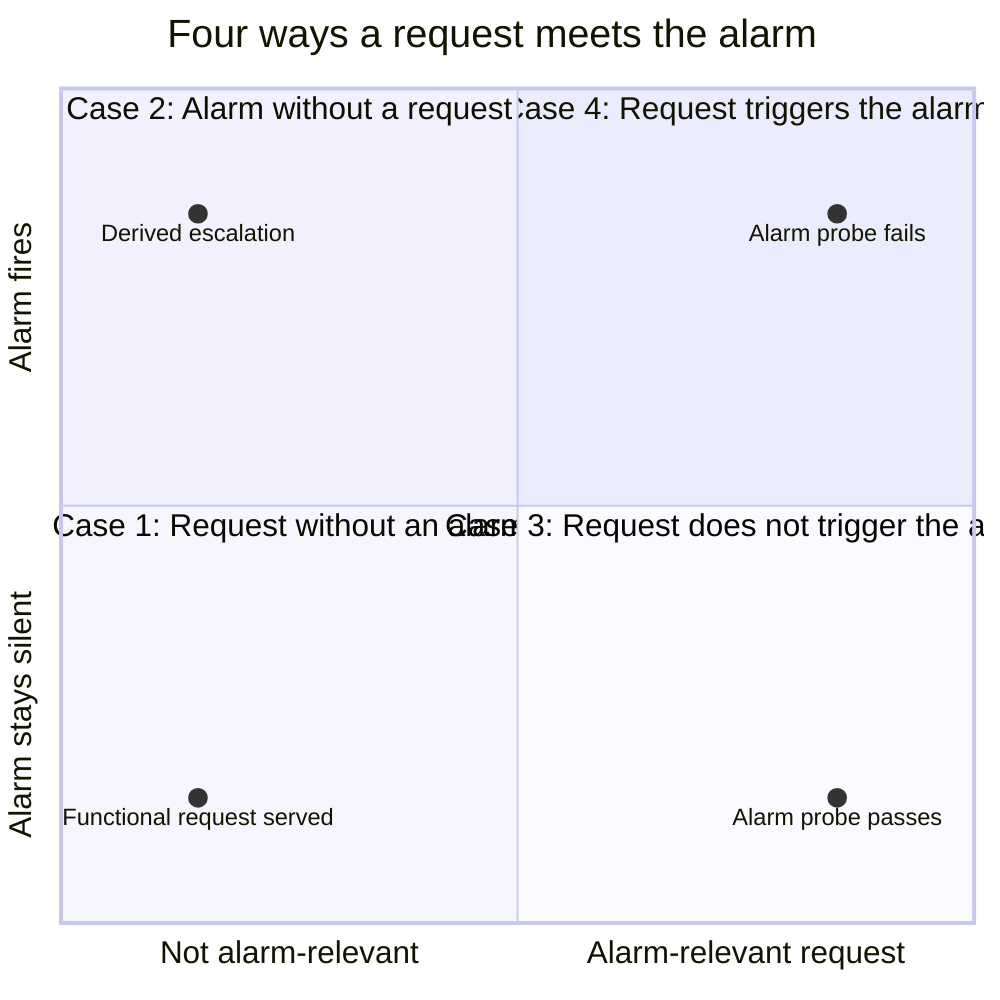
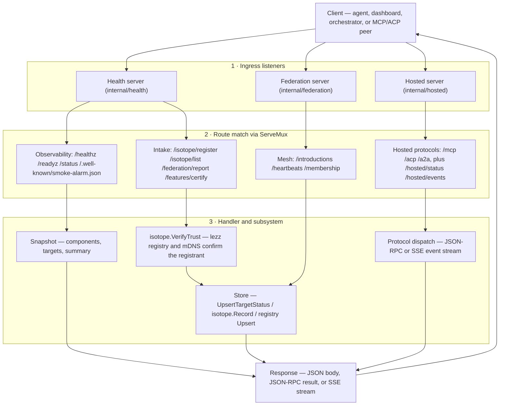
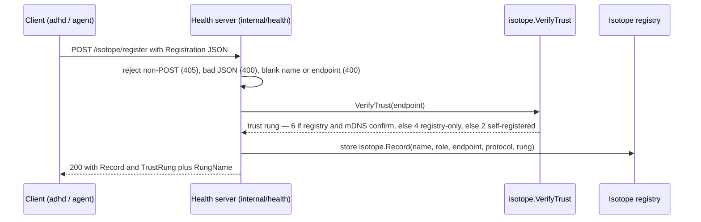
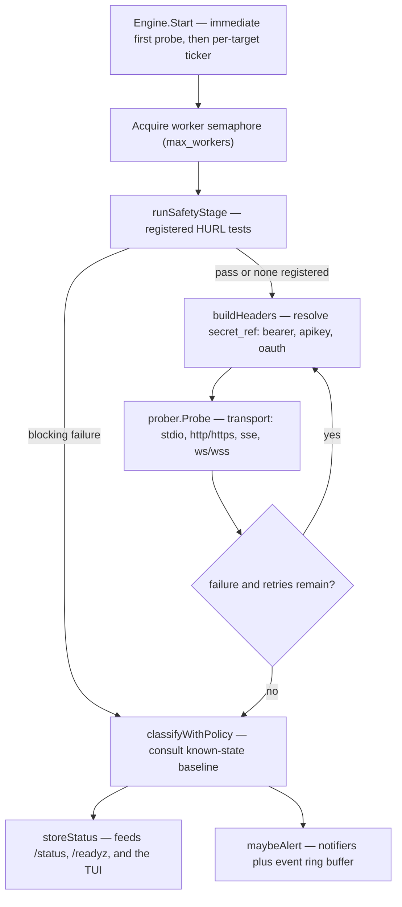
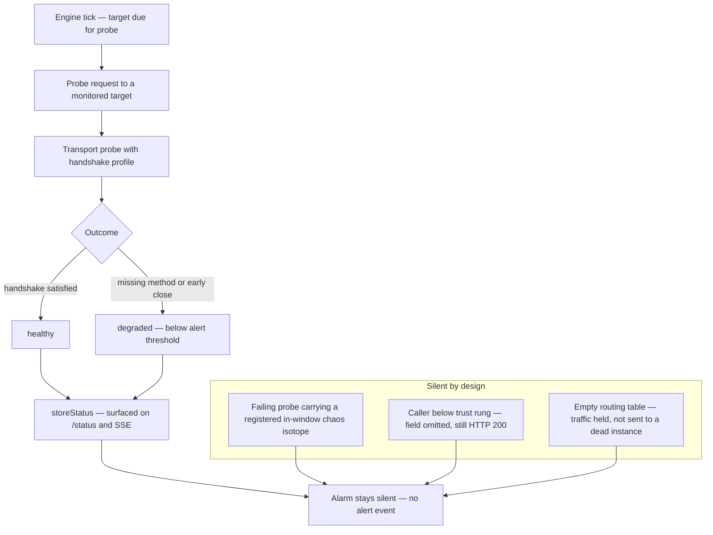
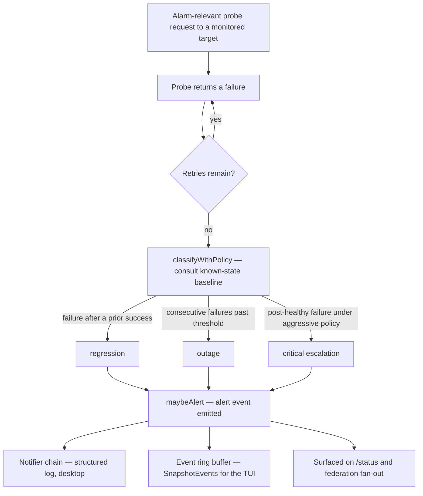

# Client Request Flow Through the Smoke Alarm

This document traces a request **from the client, through `ocd-smoke-alarm`, and back**. "Request" is deliberately broad here: it covers both a client request aimed at the alarm's surfaces and the alarm's own probe request aimed at a monitored target. Because "request flow" is ambiguous, the diagrams are organised around **four distinct ways a request meets the alarm**, separated by two questions:

- **Does the request carry alarm semantics?** A *functional* request (a client polling or registering) has none; an *alarm-relevant* request is the probe the alarm aims at a monitored target.
- **Does the alarm fire?** Whether an alert event is ultimately emitted.

| | Alarm stays silent | Alarm fires |
|---|---|---|
| **No alarm-relevant request** | **Case 1 · Request without an alarm** — a functional request is served, nothing fires | **Case 2 · Alarm without a request** — the alarm fires with no attributable request |
| **Alarm-relevant request** | **Case 3 · Request that doesn't trigger the alarm** — the probe completes quietly | **Case 4 · Request that triggers the alarm** — the probe fails and escalates |

Read as a rough confusion matrix, Cases 3 and 4 are the alarm's true negative and true positive; Case 1 is traffic the alarm is simply not judging, and Case 2 is a fire it cannot pin to a single request.

> [!NOTE]
> Derived from [the repository README](../README.md) and the [feature catalog](features/index.md). The `.feature` files remain the source of truth for behaviour; this is a process view assembled from the README plus the catalog docs. See [Sources](#sources).

## Actors and entry points

| Client | Entry surface | Purpose |
|---|---|---|
| Agent / dashboard (e.g. ADHD) | `/status`, SSE streams, `/isotope/register` | Poll health, register for a trust rung |
| Orchestrator / agent | `/healthz`, `/readyz` | Liveness and readiness gating |
| Downstream agent | `/.well-known/smoke-alarm.json` | Discover capabilities and endpoints |
| MCP / ACP / A2A client | hosted `/mcp`, `/acp`, `/a2a` | Connect to the embedded protocol server |
| Federation peer | `/introductions`, `/heartbeats`, `/membership`, `/federation/report` | Join the mesh and share target status |

## Case 1 — Request without an alarm

A client's functional request is served and nothing fires. Ingress is ordinary `http.ServeMux` routing, and the response is a snapshot, a stored record, or a protocol result — never an alert.

The ingress is ordinary Go `http.ServeMux` routing: each surface registers its handlers up front, then matches by path and method. Handlers that only read state serve a snapshot; handlers that change state decode, validate, and store before replying — see [Health and Status Endpoints](features/catalog/health.md).

## Inbound request reference

| Method | Path | Handler | Outcome |
|---|---|---|---|
| GET | `/healthz` | `handleHealthz` | `200 ok` / `503 unhealthy` |
| GET | `/readyz` | `handleReadyz` | `200 ready` / `503 not_ready` (with `ready_error`) |
| GET | `/status` | `handleStatus` | `200` full snapshot |
| GET | `/.well-known/smoke-alarm.json` | `handleSelfDescription` | `200` self-description / `404` when not configured |
| POST | `/federation/report` | `handleFederationReport` | `200 accepted` / `400` malformed / `405` on GET |
| POST | `/isotope/register` | `handleIsotopeRegister` | `200` with a trust-rung `Record` / `400` / `405` |
| GET | `/isotope/list` | `handleIsotopeList` | `200` records / `405` |
| GET | `/features` | `handleFeaturesList` | `200` feature certification list |
| POST | `/features/certify` | `handleFeatureCertify` | `200` / `400 id required` / `405` |
| GET / POST | `/mcp`, `/acp`, `/a2a` | `handleProtocol` | JSON-RPC result, or SSE via `?transport=sse` |
| GET | `/hosted/status`, `/hosted/events` | `handleHostedStatus`, `handleHostedEvents` | hosted telemetry |
| POST | `/introductions`, `/heartbeats` | federation server | register / refresh a peer |
| GET | `/membership` | federation server | registry snapshot (`self`, `peers`) |

The observability and federation-mesh surfaces are documented in [Health and Status Endpoints](features/catalog/health.md) and [Federation Mesh](features/catalog/federation.md); the self-description document is detailed in [Self-Description Endpoint](features/catalog/selfdescription.md); the hosted protocol endpoints are covered by [Embedded Hosted MCP/ACP Server](features/catalog/hosted-server.md).

## Worked example: isotopic registration

A client registers with `POST /isotope/register` on startup; the alarm assigns a trust rung and returns a `Record`. This is the representative inbound state-changing request.

The rung bucketing of 42i distance and the read-authorization it gates are documented in [42i Trust Rungs](features/catalog/trust-rungs.md); the registry intake path is in [Health and Status Endpoints](features/catalog/health.md).

## Case 2 — Alarm without a request

The alarm can fire on its own initiative with no attributable request. An alert is *derived* when it comes from escalation after accumulated failures, or is learned second-hand through `POST /federation/report` — nothing asked, the alarm answered. The machinery that produces these fires is the probe pipeline below, which also drives Case 3 and Case 4.

Every enabled target is probed on a timer. The alarm performs an immediate first check, then re-probes each target on its configured interval, bounded by `max_workers`. Each cycle follows the same ordered stages — the [protocol validation stages](../README.md#protocol-validation-stages) — so a bad target cannot skip ahead.

Stage by stage:

1. **Config validation** runs before any probe — required fields and transport/protocol vocabulary are checked at startup, so misconfiguration is caught early ([Config Validation](features/catalog/config-validation.md), [Target Definition and Validation](features/catalog/targets.md)).
2. **Optional remote `llms.txt` enrichment** can add MCP/ACP candidates as targets before probing ([LLMs.txt Auto-Discovery](features/catalog/discovery-llmstxt.md)).
3. **Safety scan** runs registered HURL tests. A blocking failure stops the cycle at classification and the deeper protocol probe never runs ([Pre-Protocol HURL Safety Scanner](features/catalog/safety-hurl.md)).
4. **Protocol smoke** dispatches to the transport prober — stdio child processes, remote SSE, or HTTP ([Stdio MCP Probe](features/catalog/stdio-mcp.md), [SSE Transport Probe](features/catalog/sse-transport.md)).
5. **Classification** consults the known-state baseline to separate a plain failure from a regression, and escalates outages under the aggressive policy ([Probe Engine](features/catalog/engine.md), [Known-State Regression Detection](features/catalog/known-state.md)).

### Classified states

| State | Trigger |
|---|---|
| `healthy` | Probe succeeded |
| `degraded` | Partial handshake, missing required method, or prematurely closed stream |
| `unhealthy` | Probe error, auth failure, or blocked safety stage |
| `regression` | Failure after a previously healthy baseline ([Known-State Regression Detection](features/catalog/known-state.md)) |
| `outage` | Consecutive failures past the threshold |
| `unknown` | Unrecognized state string |

Results feed `SnapshotStatuses` for `/status` and the TUI, and escalated states emit alert events through the notifier chain ([Alert Routing and Severity Policy](features/catalog/alerts.md)).

## Case 3 — Request that doesn't trigger the alarm

An alarm-relevant request completes without a fire. This is the alarm's **true negative**: the probe ran, the result was healthy (or degraded below the alert threshold), and the only output is a snapshot update. Some paths are silent *by design* rather than by health:

- **Healthy or degraded:** the result is recorded and visible, but only escalating states alert ([Probe Engine](features/catalog/engine.md)).
- **Chaos suppression:** a failing probe is not a real failure when it carries a registered, in-window chaos isotope — the isotope is the proof ([MCP/ACP Priority Routing and Self-Healing](features/catalog/routing.md), [Chaos Window Registration and Isotope Classification](features/catalog/chaos-window.md)).
- **Rung gating:** a below-rung caller gets fields omitted and never learns they were withheld — the response stays a structural success ([42i Trust Rungs](features/catalog/trust-rungs.md)).

## Case 4 — Request that triggers the alarm

The same alarm-relevant request, but it fails and escalates. Retries exhaust first, then the classifier consults the known-state baseline and policy, and any escalating state emits an alert event.

A blocking HURL safety failure takes the same escalation path without ever reaching the transport probe ([Pre-Protocol HURL Safety Scanner](features/catalog/safety-hurl.md)). Regression versus a plain first failure is decided by the baseline ([Known-State Regression Detection](features/catalog/known-state.md)), and severity policy decides dispatch ([Alert Routing and Severity Policy](features/catalog/alerts.md)).

## What the client observes

| Client goal | Reads | Notes |
|---|---|---|
| Is the process up? | `/healthz` | 503 once shutdown clears liveness |
| Are dependencies ready? | `/readyz` | Composite of readiness components |
| Full target picture | `/status` | Service identity, uptime, components, targets, summary |
| Discover capabilities | `/.well-known/smoke-alarm.json` | Generated from the running config |
| Register for trust | `POST /isotope/register` | Returns a `Record` with a trust rung |
| Live transitions | SSE status stream | Emits per-cycle updates including `isotope_id` ([Isotope ID Transit](features/catalog/isotope-transit.md)) |

## Cross-references

- [Feature Knowledge Base](features/index.md) — navigation hub for the derived catalog
- [Transport & Protocol](features/subsystems/transport.md) — how the alarm reaches MCP/ACP services
- [Health & Status](features/subsystems/health-status.md) — the observability subsystem
- [Operations & Safety](features/subsystems/ops-safety.md) — safety gate, routing, alerts, telemetry
- [MCP/ACP Priority Routing and Self-Healing](features/catalog/routing.md) — how traffic shifts across paths
- [Request-Pathing Blast Radius and Fault Tolerance](pathing-blast-radius.md) — availability terms and blast-radius bounds for each pathing style

## Sources

All sources are local to this knowledge base:

- [ocd-smoke-alarm — Continuous Health Monitor](../README.md) — endpoint tables, core behaviours, protocol validation stages
- [Health and Status Endpoints](features/catalog/health.md) — handler surfaces, methods, and outcomes
- [Embedded Hosted MCP/ACP Server](features/catalog/hosted-server.md) — hosted `/mcp` and `/acp` endpoints
- [Self-Description Endpoint](features/catalog/selfdescription.md) — the well-known document
- [Federation Mesh](features/catalog/federation.md) — introducer endpoints and membership
- [Probe Engine](features/catalog/engine.md) — scheduling and classification
- [Pre-Protocol HURL Safety Scanner](features/catalog/safety-hurl.md) — the safety gate
- [Config Validation](features/catalog/config-validation.md) and [Target Definition and Validation](features/catalog/targets.md) — pre-probe validation
- Source files: `internal/health/server.go`, `internal/hosted/server.go`, `internal/federation/server.go`, `internal/engine/engine.go`
